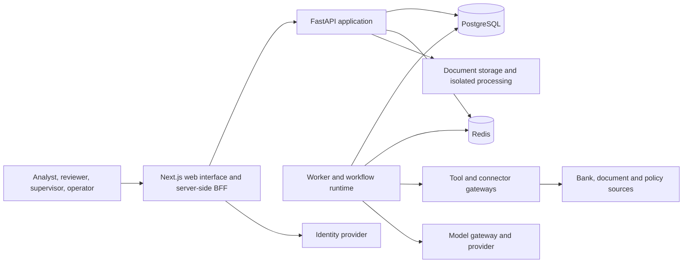
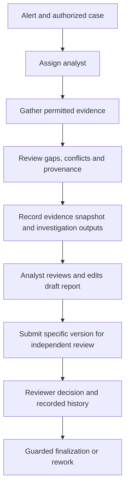
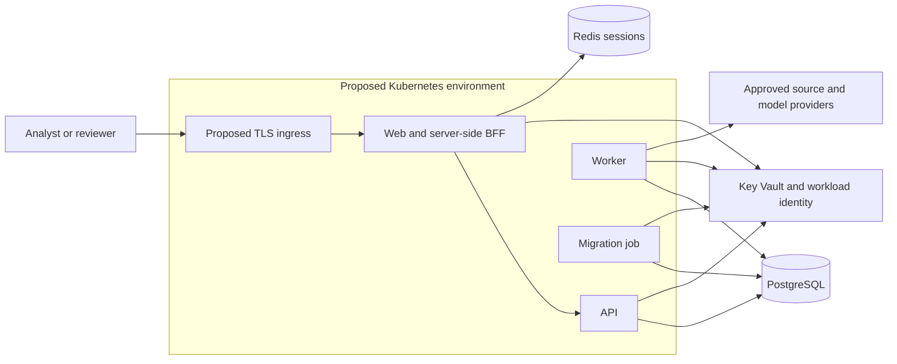

# FinAgent enterprise architecture

**Status: working architecture baseline, 2026-11-19.** The repository contains a synthetic AML investigation system and a developing analyst workspace. This document describes the source and proposed enterprise boundaries; it is not proof of production deployment, institutional approval, performance, or regulatory compliance. Live integration and release decisions remain open in the [decision register](../decisions/open-decisions.md).

## 1. Purpose and boundaries

FinAgent supports people investigating financial-crime alerts by collecting authorized evidence, recording its provenance, preparing draft analysis and reports, and routing decisions to independent reviewers. The current local demonstration uses synthetic identities and data. An AI finding is a draft and does not establish wrongdoing. Any external case-status write is a separate, guarded integration; local demonstrations must not be described as a live banking integration.

The intended organization must define its jurisdiction, permitted use cases, decision rights, source systems, and accountable owners before production use. Those decisions are not supplied by this repository.

## 2. Stakeholders and business capabilities

| Stakeholder | Principal responsibility | Supporting capability |
|---|---|---|
| Analyst | Investigate assigned alerts and prepare a draft | Case queue, evidence, documents, agent findings and report |
| Independent reviewer | Assess the submitted case and make an authorized decision | Review queue, version and evidence context, decision workflow |
| Supervisor | Oversee workload and exceptions | Assignment, escalation, reopening and case oversight |
| Policy administrator | Manage policy material | Policy lifecycle, approval and retrieval |
| Platform operator | Maintain service health and investigate operational failures | Workflows, operational dashboard and recovery |
| Auditor | Inspect authorized records | Audit metadata and approved evidence access |
| Security, privacy, compliance and data owners | Set institutional controls and approve use | Identity, access, source agreements, risk and release decisions |

These responsibilities describe intended use, not a substitute for the actual permission rules. The code and [access-control summary](../security/access-control.md) are the starting point for the role matrix; the institution must approve its own matrix and separation of duties.

## 3. System context

The diagram groups responsibilities, not deployment units or a verified production network. Local development uses synthetic source systems and model behavior. Azure and other provider adapters, infrastructure templates and deployment guidance exist, but their live operation remains unverified. See [deployment guidance](../operations/deployment.md) and the [source register](../data/source-register.md).

## 4. Application and information architecture

| Area | Repository entry point | Responsibility and key boundary |
|---|---|---|
| Web portal and workspace | `apps/web` | Role-aware screens and server-side API access; sample workspace features must remain labeled |
| HTTP API | `src/finagent/api` | Authenticated endpoints, request validation and service invocation |
| Case and review | `src/finagent/services` | Case lifecycle, evidence, reports, approval and audit operations |
| Agent capabilities | `src/finagent/agents` | Registry, model gateway, outputs and deterministic validation; candidate assistant remains disabled |
| Workflow and worker | `src/finagent/orchestration`, `src/finagent/worker` | Recorded execution, checkpoints, leases and asynchronous processing |
| Document processing | `src/finagent/documents` | Format checks, scanning interface, parsing, extraction and storage |
| Integrations | `src/finagent/integrations` | Authorized tool execution, source adapters and resilience |
| Data and migrations | `src/finagent/database` | Relational records, tenant-scoped models, migrations and database grants |
| Evaluation | `src/finagent/evaluation` | Synthetic datasets, evaluation logic and recorded results |

Core information includes tenants and principals, cases and assignments, source evidence and its versions, document versions and extracted fields, evidence snapshots, workflow runs, findings and calculations, report versions, approvals, audit events, and configuration/evaluation records. Treat evidence timestamps and snapshots as historical context: different records may describe different points in time. Data ownership, classification, lawful basis, retention and deletion require institutional decisions.

## 5. Investigation flow

Availability, authorization, data quality, conflicts, stale snapshots, model errors, and invalid reports can interrupt this flow. UI visibility is not authorization: the API and relevant service remain authoritative. Reviewers must inspect original evidence and exercise judgment. For local demonstrations see the [workspace walkthrough](../workspace-demo-walkthrough.md) and [acceptance journey](../testing/acceptance-journey.md).

## 6. Trust and security boundaries

1. Browser to web server: authenticated session, server-side access to API credentials and explicit session-expiry behavior. Restoring a selected case after sign-in remains unfinished.
2. Web/API to business services: tenant, principal, role and case scope must be checked server-side; privileged operations may require step-up authentication.
3. Integration gateway to sources: allowed tools, purpose, subject, data classes and time windows constrain access. External data and document text are untrusted.
4. Document intake to parser: scan, quarantine and isolation are separate controls; live scanning, resource limits and deployment isolation need target-environment verification.
5. Model boundary: the gateway controls provider calls and budgets; deterministic validation and evidence references constrain output. Exact matching is not proof of truth or relevance.
6. External side effects: idempotency, authorization, review and reconciliation are required where configured. Ambiguous outcomes require investigation rather than blind retry.
7. Audit and operations: audit records, monitoring and recovery need independent access controls, retention and operational ownership.

These are design boundaries, not independent assurance findings. See [security](../security/access-control.md), [tool permissions](../agents/tool-permission-matrix.md), and [architecture decisions](../adr/).

## 7. Deployment and operations

Local development uses a web server, API, worker, PostgreSQL, Redis and synthetic integrations.
Docker Compose, Helm and Terraform are development/reference artifacts. The Terraform and Helm
references have passed local checks and the infrastructure job in
[GitHub Actions run #24](https://github.com/zenithdevelopers7-source/finagent-enterprise/actions/runs/44878502791);
the [validation record](../05-testing-evidence/15-LOCAL-INFRASTRUCTURE-VALIDATION.md) describes
their scope. These checks do not establish that Azure resources exist or that a deployment works.

The following is a **proposed staging view**, not a deployed or approved network design. The
chart and Terraform files are references; service-account bindings, private connectivity,
certificate trust, database roles and the Azure identity connection need environment-specific
decisions and verification.

The arrows show proposed dependencies, not unrestricted traffic or verified connectivity. A target
enterprise deployment must establish network topology, secret management, observability, capacity,
backup and restore, recovery objectives and a release process. The migration job's default-deny
and secret bootstrap behavior also requires validation in the actual cluster.

## 8. Architecture decisions and dependencies

- Repository decisions under `docs/adr/` describe selected design choices, including workflow ownership, tenant keys, tool gateways, evidence snapshots and model validation.
- Business and technical defaults labeled proposed or local are not production decisions. Owners and dates remain open in the [decision register](../decisions/open-decisions.md).
- Source-system ownership, contracts and access approval remain open in the [source register](../data/source-register.md).
- User interface acceptance and broader production gates remain open in the [UI and system tracker](../production-ui-work-tracker.md).
- Current assessment and stale historical evidence must be reconciled against the exact tested commit before any release decision.

## 9. Items needed for an institution-specific architecture

Named business and control owners; authoritative process maps and approved jurisdictional requirements; actual source-system contracts and data flows; target cloud and residency decisions; validated threat model and data classification; approved SLOs and recovery targets; identity and authorization matrix; independent AI evaluation criteria; deployment design and operational ownership; and traceable acceptance evidence. Until these exist, this document is an engineering baseline rather than a signed enterprise architecture.
